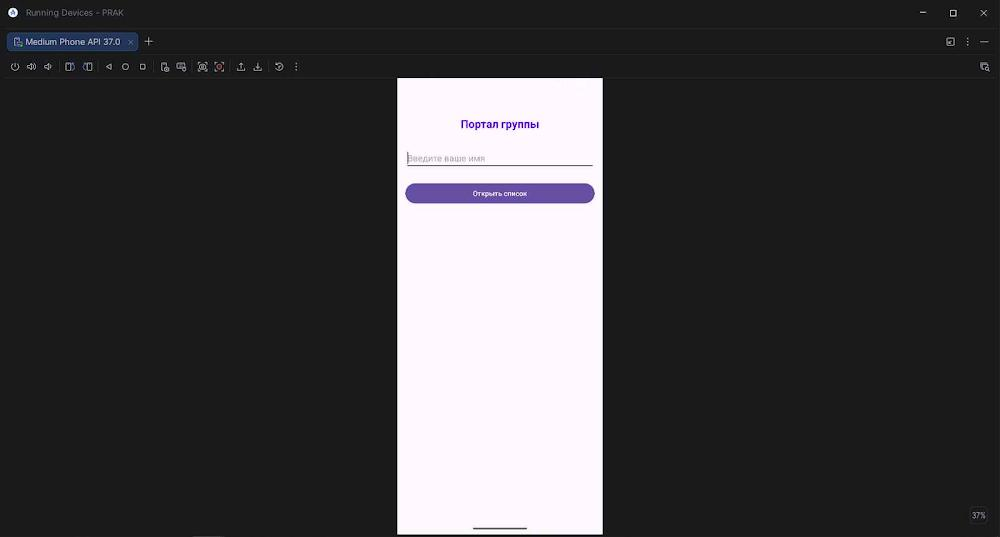
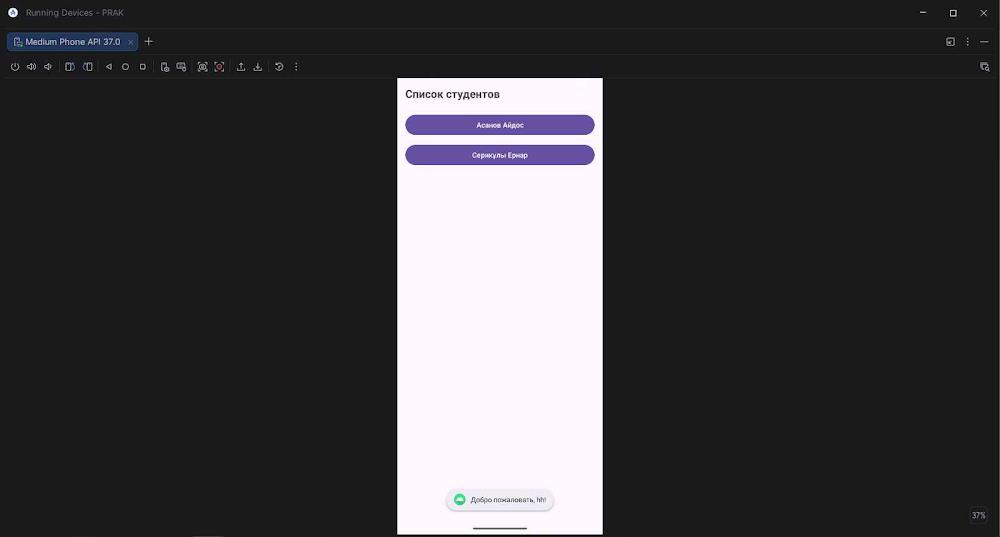
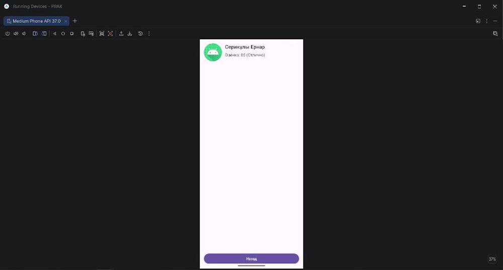

# Портал группы — Приложение «Студенты и оценки»

Мобильное приложение для просмотра списка студентов группы и их оценок на языке Kotlin для ОС Android.
Разработано в рамках практической работы по теме: **«Основы разработки Android-приложений на языке Kotlin: Activity, явные Intent, ViewGroup-разметка и логирование»**.

---

## Описание приложения

Приложение состоит из трёх экранов:

1. **MainActivity (Главный экран):** Ввод имени пользователя и кнопка перехода к списку студентов. Свёрстан на базе `LinearLayout`.
2. **ListActivity (Список студентов):** Список студентов в виде кнопок выбора: «Асанов Айдос» и «Серикұлы Ернар». Свёрстан на базе `LinearLayout`.
3. **DetailActivity (Карточка студента):** Подробная информация о выбранном студенте (имя, оценка 92 / 85) и кнопка «Назад». Свёрстан на базе `RelativeLayout`.

---

## Скриншоты экранов

| Главный экран | Список студентов | Карточка: Асанов Айдос | Карточка: Серикұлы Ернар |
|:---:|:---:|:---:|:---:|
|  |  |  |  |

---

## Технические характеристики

- **Язык разработки:** Kotlin
- **Интерфейс:** Classic View System (XML)
- **Минимальная версия SDK (`minSdk`):** 26 (Android 8.0 Oreo)
- **Целевая версия SDK (`targetSdk`):** 35
- **Версия компиляции (`compileSdk`):** 35

---

## Логирование

Все вызовы методов жизненного цикла Activity и действия пользователя фиксируются с помощью системного класса `android.util.Log`.
Полный журнал вывода сохранён в файле [logs.txt](https://github.com/taubaevbekzat/PRAKf/blob/master/logs.txt).

---

## Ссылки

-  Скачать установочный APK: [PRAKf v1.0 (Релизы)]( https://github.com/taubaevbekzat/PRAKf/releases )
- **Файл логов Logcat:** [logs.txt](https://github.com/taubaevbekzat/PRAKf/blob/master/logs.txt)

---

## Автор

*Таубаев Бекзат, Satbayev University, 2026*
